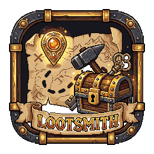
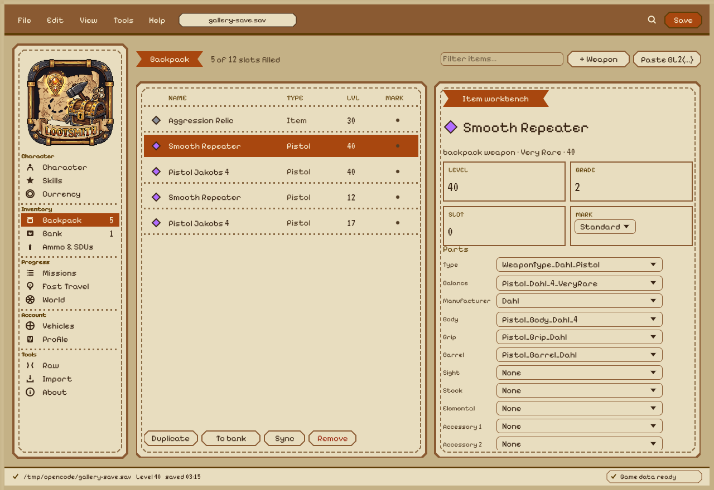
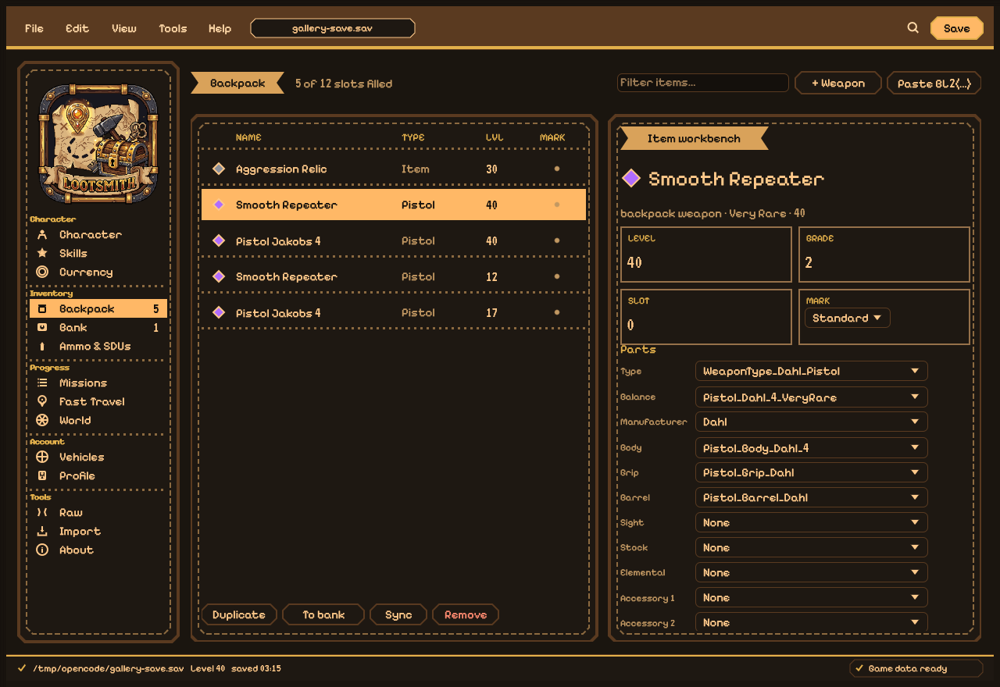
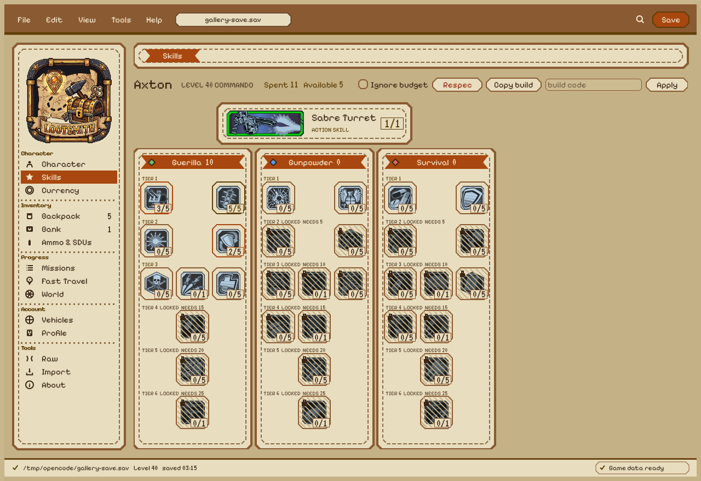
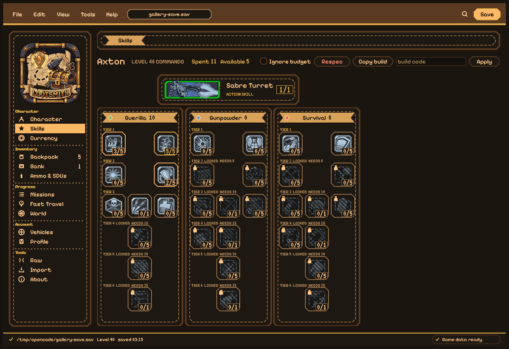

# Lootsmith

A Linux-native, Rust ([egui](https://github.com/emilk/egui)) save editor for
**Borderlands 2** — a port/replacement for Gibbed's Borderlands 2 Save Editor.

[](https://github.com/UndeadBulwark/lootsmith/actions/workflows/ci.yml)
[](LICENSE)


**Current state — `0.4.1`.** The core library and CLI are complete and validated
against real PC saves; the GUI is a full editor with a themed, responsive shell.
Status and the roadmap to 1.0 live in [`docs/PLAN.md`](docs/PLAN.md).

<p align="center">
  
</p>

<sub>Lootsmith runs in a Light theme (default) and a Dark theme — both are
shown below.</sub>

Lootsmith reads, edits, and writes Borderlands 2 save files: items, weapons,
currency, skills, and progression. It ships as a library (`lootsmith-core`), a CLI
(`lootsmith-cli`), and an `egui` desktop app (`lootsmith-gui`), with `lootsmith` as
a facade crate.

> Lootsmith is a Rust port based on Gibbed's Borderlands 2 Save Editor by Rick
> Gibbed (zlib license).

## Features

- **Save format:** LZO/zlib container (SHA-1, CRC-32, Huffman), all 58 top-level
  fields of `WillowTwoPlayerSaveGame`, byte-exact round trips.
- **Items & weapons:** part editing with balance-constrained pickers, display
  names, rarity, and `BL2(…)` item codes.
- **Skills:** every vault hunter's tree matches the in-game layout, with the real
  per-skill columns, the action-skill banner, and tier gating.
- **Everything else:** Character, Currency, Ammo & SDUs, World, Fast
  Travel, Vehicles, Missions, Backpack, Bank, Raw, Profile, Import, About.
- **Profile & Import** are full pages: edit `profile.bin` (golden keys, badass
  rank/tokens, bonuses) or copy sections from another save.
- **Save discovery:** native, Steam/Proton, and Wine prefixes.
- **Platform conversion:** PC, Xbox 360, PS3, PS Vita, Shield, Switch.
- **Keyboard:** `Ctrl+C` / `Ctrl+V` / `Ctrl+X` copy, paste and cut the selected
  item, `Ctrl+D` duplicates, `Del` removes; `Ctrl+Shift+C` copies its `BL2(…)`
  code; `Ctrl+F` focuses the filter, `Ctrl+N` / `Ctrl+Shift+N` add a weapon or
  item; `Ctrl+S` / `Ctrl+O` / `Ctrl+R` save, open and reload. Items carry a
  **mark** column — click it to cycle standard → favourite → trash.
- **Game data:** bundled community tables (with a user-folder override) so names
  resolve on a fresh run with no setup.

## Screenshots

Two screens in both themes — every page is in the
**[full gallery →](https://undeadbulwark.github.io/Lootsmith/)**.

<table>
  <tr>
    <td align="center"><a href="gallery/light/backpack-selected.png"></a><br><sub><b>Backpack &amp; workbench</b> — light</sub></td>
    <td align="center"><a href="gallery/dark/backpack-selected.png"></a><br><sub><b>Backpack &amp; workbench</b> — dark</sub></td>
  </tr>
  <tr>
    <td align="center"><a href="gallery/light/skills.png"></a><br><sub><b>Skills</b> — light</sub></td>
    <td align="center"><a href="gallery/dark/skills.png"></a><br><sub><b>Skills</b> — dark</sub></td>
  </tr>
</table>

The **[full gallery](https://undeadbulwark.github.io/Lootsmith/)** has all 14
pages (Character, Skills, Currency, Ammo & SDUs, World, Fast Travel, Vehicles,
Missions, Backpack, Bank, Raw, Profile, Import, About) in light and dark.

## Install / build

Prebuilt artifacts are attached to tagged **releases**: a Linux **Flatpak bundle**
(`.flatpak`) and a `.tar.gz`, plus a source tarball.

```sh
git clone https://github.com/UndeadBulwark/Lootsmith
cd lootsmith
cargo build --release      # binaries in target/release/
```

Rust 1.85+ is required. The GUI builds on `eframe`/`wgpu`.

## Run

```sh
# GUI
cargo run -p lootsmith-gui

# CLI — inspect a save
cargo run -p lootsmith-cli -- inspect <save.sav>
```

### CLI at a glance

```
inspect  verify  dump     items   skills  travel  vehicles  missions  saves
new  json  unjson  profile  ammo  sdus  challenges  world  edit
```

`edit` covers level/points, currency, golden keys, bank slots, `--item/--part/--set`,
`--skill`, travel, `--steering-mode`, missions, `--ammo/--amount/--sdu`,
`--market … --sdu-level L`, `--backpack-slots`, `--bank-size`, `--max-sdus`, with
`--out`, `.bak` backups, and re-verify.

## Workspace layout

| Crate | Purpose |
|---|---|
| `lootsmith-core` | Container, bit/Huffman codecs, protobuf codec, item codec, game data |
| `lootsmith-cli`  | Thin command layer over core (binary `lootsmith`) |
| `lootsmith-gui`  | egui desktop app |
| `lootsmith`      | Facade crate |

Bundled game-data tables live under `crates/lootsmith-core/assets/data/`; their
sources, revisions, and licences are recorded in
[`PROVENANCE.md`](crates/lootsmith-core/assets/data/PROVENANCE.md). A folder you
pick always overrides the bundled copy.

## Development

```sh
cargo build --release
cargo clippy --workspace --all-targets -- -D warnings   # must stay clean
LOOTSMITH_REQUIRE_FIXTURES=1 cargo test --workspace
cargo run -p lootsmith-gui --example snapshot -- /tmp/shots
```

The GUI test suite runs on a synthetic fixture (`lootsmith_core::fixture`), never a
personal save; snapshot baselines live in `crates/lootsmith-gui/tests/snapshots/`.
See [`AGENTS.md`](AGENTS.md) and [`docs/PLAN.md`](docs/PLAN.md) for the milestone
gate and current roadmap.

## Credits & licence

- Original tool: Gibbed's Borderlands 2 Save Editor by Rick Gibbed.
- Lootsmith is licensed under the [Zlib licence](LICENSE).

## AI disclaimer

Made with the assistance of AI and primarily for personal use. Use at your own
risk.
