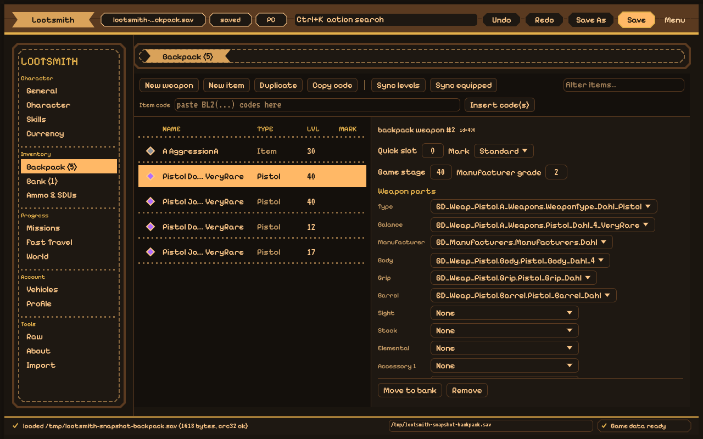
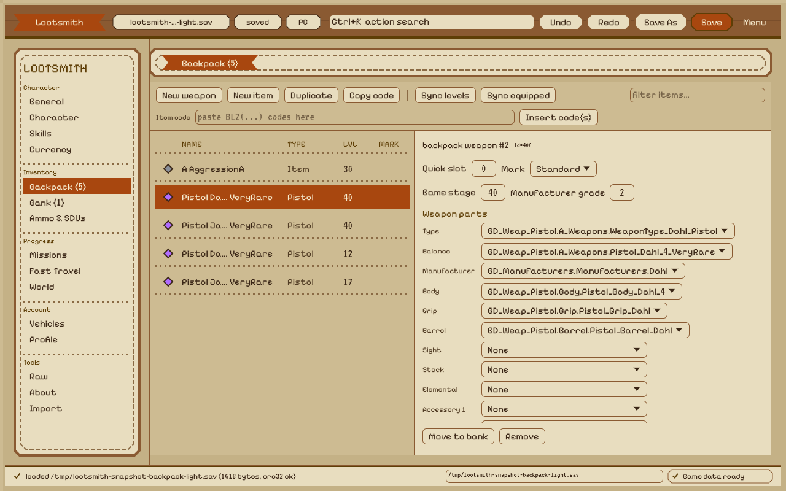

# Lootsmith

A Linux-native, Rust ([egui](https://github.com/emilk/egui)) save editor for
**Borderlands 2** — a port/replacement for Gibbed's Borderlands 2 Save Editor.

[](https://github.com/UndeadBulwark/lootsmith/actions/workflows/ci.yml)
[](LICENSE)


**Current state:** core + CLI complete and validated against a real PC save; the
GUI is a full editor with a themed shell. Roadmap to 1.0: [`docs/PLAN_1_0.md`](docs/PLAN_1_0.md).




<sub>Current dark/light Backpack screens; the design mockups are in
[`docs/screenshots/mockup-backpack-dark.png`](docs/screenshots/mockup-backpack-dark.png)
and `mockup-backpack-light.png`.</sub>

> Lootsmith is a Rust port based on Gibbed's Borderlands 2 Save Editor by Rick
> Gibbed (zlib license).

Lootsmith reads, edits, and writes Borderlands 2 save files: items, weapons,
currency, skills, and progression. It ships as a library (`lootsmith-core`), a
CLI (`lootsmith-cli`), and (later) an `egui` desktop app (`lootsmith-gui`),
with `lootsmith` as a facade crate. The GUI is a full editor (General, Character,
Currency, Skills, Fast Travel, Vehicles, Missions, Backpack, Bank, Raw) with a
toolbar, item codes and a themed shell; see [`docs/PLAN.md`](docs/PLAN.md) and the
[1.0 roadmap](docs/PLAN_1_0.md).

## Workspace layout

| Crate | Purpose |
|---|---|
| `lootsmith-core` | Container, bit/Huffman codecs, protobuf codec, item codec, game data |
| `lootsmith-cli` | `inspect`, `verify`, `dump`, `items`, `edit` |
| `lootsmith-gui` | `egui` desktop front end (library + binary) |
| `lootsmith` | Facade re-exporting `lootsmith-core` |

## Save format (verified against upstream `SaveFile.cs`)

```
File (PC / X360 / PS3 / PSVita / Shield)
  = SHA1(20)                    // over everything below
  || u32BE(inner_len)
  || compress(Inner)            // LZO (PC, X360) or Zlib (PS3, PSVita, Shield)

Inner (compressed platforms; the 4-byte prefix is present only here)
  = u32BE(inner_size = len(Inner) - 4)
  || "WSG"
  || u32(version = 2)           // platform endian
  || u32(crc32(proto_bytes))    // platform endian
  || i32(proto_size)            // platform endian
  || Huffman(proto_bytes)       // Gibbed.Gearbox.Common.Huffman

File (Switch, compression = None)
  = "WSG" || u32 version || u32 crc32 || i32 size || Huffman(proto_bytes)
```

When `len(Inner) > 0x40000`, the compressed payload is a block table:
`u32BE(block_count)` then `block_count x (u32BE compressed, u32BE uncompressed)`
then the concatenated blocks.

The outer compressed bytes are **not** byte-identical across compressors, so
Lootsmith gates on the unwrapped `Inner` buffer and the protobuf payload, not
on the whole file.

## Using the CLI

```sh
cargo run -p lootsmith-cli -- inspect /path/to/Save0001.sav
cargo run -p lootsmith-cli -- verify  /path/to/Save0001.sav
cargo run -p lootsmith-cli -- dump    /path/to/Save0001.sav
cargo run -p lootsmith-cli -- saves
cargo run -p lootsmith-cli -- items   /path/to/Save0001.sav --dumps "/path/Asset Library Manager.json"
cargo run -p lootsmith-cli -- items   /path/to/Save0001.sav --container bank
cargo run -p lootsmith-cli -- skills  /path/to/Save0001.sav
cargo run -p lootsmith-cli -- travel  /path/to/Save0001.sav --stations "/path/Travel Stations.json"
cargo run -p lootsmith-cli -- vehicles /path/to/Save0001.sav --customizations "/path/Customizations.json"
cargo run -p lootsmith-cli -- missions /path/to/Save0001.sav --missions-json "/path/Missions.json"
cargo run -p lootsmith-cli -- ammo    /path/to/Save0001.sav
cargo run -p lootsmith-cli -- sdus    /path/to/Save0001.sav
cargo run -p lootsmith-cli -- challenges /path/to/Save0001.sav
cargo run -p lootsmith-cli -- world   /path/to/Save0001.sav
```

Edit one ammo pool, one Black Market SDU, one challenge value, or run the
bulk operations:

```sh
cargo run -p lootsmith-cli -- edit /path/to/Save0001.sav --ammo 5 --amount 999 --sdu 3 --out /path/to/edited.sav
cargo run -p lootsmith-cli -- edit /path/to/Save0001.sav --market Backpack --sdu-level 3 --out /path/to/edited.sav
cargo run -p lootsmith-cli -- edit /path/to/Save0001.sav --challenge-stat 1623 --value 500 --prestige 2 --out /path/to/edited.sav
cargo run -p lootsmith-cli -- edit /path/to/Save0001.sav --max-sdus --out /path/to/edited.sav
cargo run -p lootsmith-cli -- edit /path/to/Save0001.sav --explore-all --clear-lockouts --clear-mementos --complete-all-missions --unlock-all-travel --stations "/path/Travel Stations.json" --out /path/to/edited.sav
cargo run -p lootsmith-cli -- edit /path/to/Save0001.sav --game-stage "Zone1.Sanctuary" --stage 40 --out /path/to/edited.sav
```

Edit an ammo pool's current amount and SDU upgrade level:

```sh
cargo run -p lootsmith-cli -- edit /path/to/Save0001.sav --ammo 5 --amount 999 --sdu 3 --out /path/to/edited.sav
```

Start a fresh save, and convert saves to/from wire-faithful JSON:

```sh
cargo run -p lootsmith-cli -- new --class soldier --out /path/to/NewSave.sav
cargo run -p lootsmith-cli -- json   /path/to/Save0001.sav --out /path/to/save.json
cargo run -p lootsmith-cli -- unjson /path/to/save.json --out /path/to/rebuilt.sav
```

`new` writes a blank, spec-driven level-1 save for the chosen class
(soldier/axton, siren/maya, mercenary/salvador, assassin/zer0, lilac/krieg/
psycho, tulip/gaige/mechromancer; full class ids also accepted) — blank saves
are experimental, in-game verification recommended. `json` dumps every top-level
field preserving order, duplicates and wire types (nested messages, base64
blobs); `unjson` rebuilds a save byte-identically.

`saves` lists the Borderlands 2 saves found on this machine (native Linux port,
Steam/Proton prefixes, and Wine/Lutris/custom prefixes).

`items` lists the backpack (fields 53/54) and the bank (field 41); pass
`--container bag|bank` to filter (default `all`). `skills` lists the skill tree
(`SkillData`, field 8) with each node's grade and points. `travel` lists the
visited fast-travel stations (fields 16/17), resolved through `Travel Stations.json`.
`vehicles` lists the chosen vehicle skins (field 57) and steering mode (field 58),
resolved through `Customizations.json`. `missions` lists the plot/active mission
numbers, each playthrough's missions with their status, and the challenge list
(fields 18/21/37/38), resolved through `Missions.json`.

Edit and write (in place with a `.bak` backup, or with `--out`):

```sh
cargo run -p lootsmith-cli -- edit /path/to/Save0001.sav \
    --level 61 --currency 1234567 --golden-keys 42 --out /path/to/edited.sav
```

Every command defaults to the PC platform (`--platform pc`). `--dumps` (or
`LOOTSMITH_ASSET_LIBRARY`) points at the Gibbed `Asset Library Manager.json` so
asset indices resolve to names; without it the CLI prints raw indices.

Edit a weapon part by name:

```sh
cargo run -p lootsmith-cli -- edit /path/to/Save0001.sav \
    --item 6 --part elemental --set "GD_Weap_Pistol.elemental.Pistol_Elemental_Fire" \
    --dumps "/path/Asset Library Manager.json" --out /path/to/edited.sav
```

`--item N` indexes the backpack (fields 53 then 54); add `--container bank` to
address a bank entry (field 41) instead.

Edit a skill's grade and grade points by index (1-based, as shown by `skills`):

```sh
cargo run -p lootsmith-cli -- edit /path/to/Save0001.sav \
    --skill 4 --grade 5 --points 5 --out /path/to/edited.sav
```

Add, remove, or change the last visited fast-travel station:

```sh
cargo run -p lootsmith-cli -- edit /path/to/Save0001.sav \
    --travel-add Xmas --travel-last Xmas --out /path/to/edited.sav
```

Change the vehicle steering mode (0/1/2):

```sh
cargo run -p lootsmith-cli -- edit /path/to/Save0001.sav \
    --steering-mode 0 --out /path/to/edited.sav
```

Set the plot/active mission number, or a single mission's status (name from
`NotStarted`/`Active`/`RequiredObjectivesComplete`/`ReadyToTurnIn`/`Complete`/`Failed`,
with playthrough/mission indexes as shown by `missions`):

```sh
cargo run -p lootsmith-cli -- edit /path/to/Save0001.sav \
    --plot-mission 19 --active-mission 19 --out /path/to/edited.sav

cargo run -p lootsmith-cli -- edit /path/to/Save0001.sav \
    --mission-playthrough 0 --mission-index 18 --mission-status Complete --out /path/to/edited.sav
```

## GUI

```sh
cargo run -p lootsmith-gui
# or open a specific save / game-data folder:
cargo run -p lootsmith-gui -- --open "/path/to/Save0001.sav" \
    --dumps "/path/to/gibbed-dumps"
```

A native window with a toolbar (**Open / Find saves / Save / Save As / Reload /
New… / Import… / Profile… / platform / Game data**, with `Ctrl+O/S/Shift+S/R`)
and tabs **General / Character / Currency / Skills / Fast Travel / Vehicles /
Missions / Backpack (n) / Bank (n) / Raw / About**, a light/dark theme toggle,
and a status bar. Lootsmith **finds your saves
automatically** — native Aspyr, Steam/Proton (appid 49520, all Steam roots incl.
Flatpak), and generic Wine/Lutris/custom prefixes like a ZLuda prefix under
`$HOME` — and on first run opens the newest one. **Find saves** lets you pick
from what it found. Pick the **game-data folder** once (the directory holding
`Asset Library Manager.json`) and the Asset Library, Travel Stations,
Customizations and Missions tables are all loaded from it, so names resolve
everywhere. The **platform combo** next to Save As… writes PC/PS3/X360/… container
formats for porting saves between platforms. **Profile…** edits `profile.bin` —
the account-wide file holding golden keys, badass rank & tokens, the 14 badass
bonus stats, and the head/skin unlock list (unlock everything, or set keys;
`.bak` backup on save). The CLI equivalent is
`lootsmith profile <profile.bin> --golden-keys N --badass-rank N
--badass-tokens N --unlock-customizations`.

Tabs: **General**, **Character** (name, level, class, overpower), **Currency**
(named money/eridium/seraph/torgue), **Ammo** (per-pool amount + SDU level +
Storage Deck Upgrades with Max all + backpack/bank slot editors), **World**
(discoveries, region game stages, lockouts, DLC expansions, mementos with
Mark all explored / Clear lockouts / Clear mementos), **Skills**, **Fast Travel**, **Vehicles**,
**Missions**, **Backpack**, **Bank**, and **Raw** (edit any scalar top-level
field). The **General** tab has Max / OP-max level buttons (72 / 80).
**Backpack/Bank rows and the item inspector show the item's composed display
name** (from the `Weapon/Item Name Parts` dumps) instead of raw asset paths;
the editor exposes **Game Stage** and **Manufacturer grade** per item. The
**Character** tab changes the class (with the DLC-class flags) and shows the
**Overpower level** (resettable). **Fast Travel** groups stations by DLC with
per-group **Check all / Uncheck all**. A **search box** filters the Raw list;
the item table's **filter** also matches display names. **New…**
creates a fresh character save — clone-and-reset (reliable) or a spec-driven
blank save (experimental); **Import…** copies chosen sections (skills, missions,
challenges, fast travel, vehicles, DLC data, bank slots) from another save into
the open one. The **Skills** tab is a full skill-tree
calculator (like bl2skills.com): per-class trees with tiers, icons and max ranks,
left-click to add a rank and right-click to remove, tier gating at 5 points per
tier, and live spent/available counts. The Backpack/Bank tabs create blank
weapons/items, duplicate, **copy/paste `BL2(...)` item codes**, sync item levels,
set a stack quantity/mark/quick-slot, **edit every part** with balance-constrained
part pickers (from the `Balance Part Lists` dumps; "Complete" balances offer only
the parts that balance allows), move bank↔backpack, and
remove. Changes mark the document as unsaved; Save writes in place with a `.bak`.
Settings (paths, theme, tab) persist between runs.

### Desktop launcher (interim)

`scripts/lootsmith-gui` builds the release binary on first run and launches it.
A menu entry is installed at `~/.local/share/applications/lootsmith.desktop`
(with an icon), so Lootsmith can be opened from the application menu; opening a
`.sav` with it passes the file via `%f`.

### Headless UI tests and snapshots

The GUI is driven and inspected without a window or focus, via
[`egui_kittest`](https://docs.rs/egui_kittest) (AccessKit): widgets are found by
label and clicked in-process, and screens are rendered offscreen to PNG.

```sh
# Widget-level interaction tests (click tabs/items by label, edit, save, verify)
cargo test -p lootsmith-gui

# Render the tabs/screens offscreen to PNGs for review
cargo run -p lootsmith-gui --example snapshot -- /tmp/opencode/shots
```

The UI body lives in `LootsmithApp::build`, shared verbatim by the native window
and the test harness, so tests exercise exactly what the human sees.

`scripts/gui-drive.sh` is an optional extra for watching the *live* window (it
launches on X11 and screenshots the window); it is not needed for testing.

A headless self-test (load → edit → save → reload → verify, no window):

```sh
cargo run -p lootsmith-gui -- --selftest --open tests/fixtures/pc_Save0001.sav
```

Logs go to `~/.cache/lootsmith/gui.log`.

## Tests

A real save is expected at `tests/fixtures/pc_Save0001.sav` (git-ignored). With
it present:

```sh
cargo test -p lootsmith-core
```

validates SHA1, CRC32, LZO decompression, and that the Huffman re-encode
reproduces the original inner buffer byte-for-byte.

## Fan project

Lootsmith is an unofficial fan project. It is **not affiliated with, endorsed
by, or associated with Gearbox Software or 2K Games**. "Borderlands" is a
trademark of its owners and is used descriptively only. No game art, binaries
or audio are bundled.

## Licensing

Project code is zlib, inherited from upstream. Game data is **not** bundled and
must be supplied by the user; no Gearbox assets are redistributed.

Exception: the skill-tree names, descriptions and icons under
`crates/lootsmith-gui/assets/skills/` (generated by `scripts/gen-skill-data.py`
from the community calculator at bl2skills.com) are Gearbox-owned game content
included so the skill calculator works offline. Remove that directory and the
`skills` module if you need a build with no bundled game data.

### Bundled game-data tables

`crates/lootsmith-core/assets/data/` ships the community dump tables the editor
needs to resolve names (asset library, balances, part lists, name parts, travel
stations, missions, customizations, downloadable contents) plus the derived
`rarity.json`. They are **verbatim copies** of the community dumps (Gibbed's
Borderlands2Dumps, pinned) and the derived balance→rarity mapping; not art or
code. Per-table sources, revisions and licence status are in
`crates/lootsmith-core/assets/data/PROVENANCE.md`, and the whole folder can be
rebuilt with `scripts/refresh-data.sh`. A game-data folder chosen in
**Game data…** always overrides the bundled copies.
